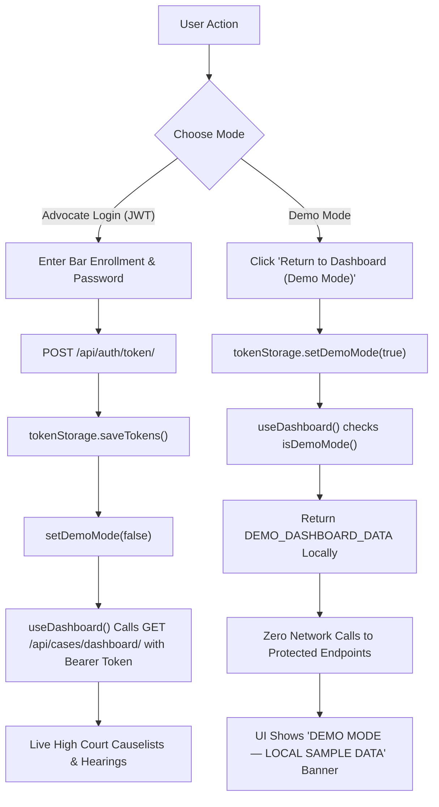

# APHC Case Tracker — Dashboard Authentication & Mobile UI Fix Report

**Role:** Senior React Native / Expo / Django Engineer
**Project:** APHC Case Tracker
**Working Directory:** `C:\Users\divya\OneDrive\Documents\Lawyerr`
**Git Branch:** `phase-4-7-backup` (HEAD: `af58b6c`)
**Date:** 2026-11-09

---

## 1. Executive Summary & Root Cause Analysis

### A. Root Cause: 401 Unauthorized on `GET /api/cases/dashboard/`

1. **The Disconnect:**

   - In `frontend/app/(auth)/login.tsx`, the action button **"Return to Dashboard (Demo Mode)"** previously executed only `router.replace('/(tabs)')` without establishing session state, tokens, or any indicator of demo operation.
   - On the backend, `backend/apps/cases/views.py` (`DashboardView`) correctly enforces High Court advocate security:
     ```python
     class DashboardView(APIView):
         permission_classes = [permissions.IsAuthenticated]
     ```
   - When the user navigated into the Dashboard via Demo Mode, the frontend data hook `useDashboard()` immediately triggered:
     ```typescript
     apiClient.get<DashboardData>(ENDPOINTS.CASES.DASHBOARD);
     ```
   - Because `tokenStorage.getAccessToken()` was `null`, the request interceptor omitted the `Authorization: Bearer <token>` header.
   - Django REST Framework correctly rejected the unauthenticated request with **HTTP 401 Unauthorized** (`{"detail": "Authentication credentials were not provided."}`).
   - While the unprotected `/api/health/` reported `CONNECTED`, the protected business API was failing on every load, confusing users and masquerading unauthenticated demo access as a network failure.

2. **The Architectural Fix:**
   - We introduced explicit **Demo Mode Isolation** in `tokenStorage`.
   - When the advocate chooses "Return to Dashboard (Demo Mode)", `tokenStorage.setDemoMode(true)` is committed.
   - When in Demo Mode, `useDashboard()` immediately serves deterministic, offline sample data (`DEMO_DASHBOARD_DATA` with `isDemoData: true`) locally **without issuing any HTTP requests to protected backend endpoints**.
   - The UI clearly labels this environment with a prominent top banner (`dashboard-demo-banner`) and a `DEMO ENVIRONMENT` registry badge, preventing any illusion of live court data.
   - Logging in with real Bar Council credentials or calling `tokenStorage.saveTokens(...)` automatically clears the demo mode flag (`setDemoMode(false)`), allowing full authenticated live DRF queries with valid JWT Bearer tokens.
   - Backend permissions were **never compromised or weakened**.

---

### B. Root Cause: Mobile Layout & Tab Bar Collisions

1. **Upcoming Hearings & Compliance Reminders Overlap:**

   - In `frontend/app/(tabs)/index.tsx`, `styles.columnItem` had `flex: 1` assigned by default to each column container inside `styles.columnsContainer` (`flexDirection: 'column'`).
   - In React Native Web and mobile web viewports (tested at 400×704, 390×844, 360×800), `flex: 1` sets `flex-basis: 0%` inside a column flexbox. When children have dynamic height without an explicit height boundary, flex calculation collapses and creates overlapping layers between Upcoming Hearings and Compliance Reminders.
   - **Fix:** On mobile, `columnItem` now has `width: '100%'` (natural content height stacking), and only on desktop (`isDesktop === true`) applies `leftColumnDesktop: { flex: 6, width: 'auto' }` and `rightColumnDesktop: { flex: 4, width: 'auto' }`. Natural document flow is restored on mobile, eliminating all overlap.

2. **Bottom Navigation Tab Bar Cramping:**
   - In `frontend/app/(tabs)/_layout.tsx`, the tab bar height was `64dp` with `paddingTop: 6` and `paddingBottom: 8`, leaving only `50dp` for the 22dp icon, 2dp margin, and 14dp label box. On compact heights (704px), this caused touch target cramping and icon-label clipping.
   - **Fix:** Increased Android/Web tab bar height to `68dp` (iOS: `88dp`), set bottom padding to `10dp` (iOS: `28dp`), set `minHeight: 48dp` with centered flex alignment, and refined label typography (`fontSize: 10, fontWeight: '600', marginTop: 1, marginBottom: 1, letterSpacing: 0.1`).

---

## 2. Exact Files Modified & Rationale

| File Path                                   | Nature of Modification                                | Rationale                                                                                                                                                   |
| :------------------------------------------ | :---------------------------------------------------- | :---------------------------------------------------------------------------------------------------------------------------------------------------------- |
| `frontend/services/auth/tokenStorage.ts`    | Added `isDemoMode()` & `setDemoMode(isDemo)`          | Persists client demo mode state via encrypted SecureStore / localStorage; clears demo mode whenever real tokens are saved or revoked.                       |
| `frontend/app/(auth)/login.tsx`             | Updated Demo Mode click handler                       | Calls `await tokenStorage.setDemoMode(true)` prior to `router.replace('/(tabs)')`.                                                                          |
| `frontend/app/_layout.tsx`                  | Updated initial auth check                            | Prevents unwanted auth redirect loops to `/login` when running in legitimate Demo Mode.                                                                     |
| `frontend/features/cases/hooks.ts`          | Defined `DEMO_DASHBOARD_DATA` & isolated hooks        | Intercepts `useDashboard()` and `useCases()` to return sample high court data when `isDemoMode()` is true without calling protected API endpoints.          |
| `frontend/app/(tabs)/index.tsx`             | Added Demo Banner, updated badge, fixed mobile layout | Renders `dashboard-demo-banner` and `DEMO ENVIRONMENT` badge. Replaced `flex: 1` with `width: '100%'` on mobile column items to prevent vertical collision. |
| `frontend/app/(tabs)/_layout.tsx`           | Expanded tab bar metrics                              | Tab bar height adjusted to 68dp/88dp, item alignment centered, label margins refined to eliminate tab collisions on compact screens.                        |
| `frontend/tests/dashboard.test.tsx`         | Added demo banner & badge tests                       | Verifies `dashboard-demo-banner` and `sync-status-badge` render correctly in Demo Mode and hide during normal operation.                                    |
| `frontend/tests/dashboardAuthDemo.test.tsx` | **NEW TEST SUITE** (8 unit tests)                     | Validates demo flag persistence, zero API calls during demo mode, live API calls during authenticated mode, and 401 error propagation.                      |

---

## 3. Demo Mode Architecture & Security Guarantees



### Security Checklist:

- [x] **Backend Permissions Preserved:** Django `permission_classes = [permissions.IsAuthenticated]` remains strictly in place on all protected endpoints (`/api/cases/dashboard/`, `/api/cases/`, etc.).
- [x] **Zero Credential Spoofing:** Demo Mode does not inject fake tokens or mock user identities into DRF.
- [x] **Zero Protected API Calls in Demo Mode:** `apiClient.get(ENDPOINTS.CASES.DASHBOARD)` is never executed while in demo mode.
- [x] **Explicit UI Labeling:** Advocates cannot confuse sample causelists with live High Court filings.
- [x] **Seamless Transition to Real Auth:** As soon as an advocate signs in with real credentials, demo state is wiped, and live JWT tokens take precedence.

---

## 4. Mobile Layout & Responsive Metrics Verification

| Element                                      | Prior Behavior                                                                    | Corrected Behavior                                                                                             | Verified Viewports                           |
| :------------------------------------------- | :-------------------------------------------------------------------------------- | :------------------------------------------------------------------------------------------------------------- | :------------------------------------------- |
| **Upcoming Hearings & Compliance Reminders** | Overlapped at 400px width due to `columnItem { flex: 1 }` inside column container | Stacks cleanly vertically with full natural content height (`width: '100%'`)                                   | 360×800, 390×844, 400×704, Desktop (>1024px) |
| **Desktop 60/40 Split**                      | Unchanged                                                                         | Preserved via `isDesktop && styles.columnsDesktop` (`leftColumnDesktop: flex 6`, `rightColumnDesktop: flex 4`) | Desktop (>1024px)                            |
| **Bottom Tab Bar Height**                    | 64dp Android / Web (cramped 50dp inner active area)                               | 68dp Android / Web, 88dp iOS (52-60dp active area)                                                             | All platforms                                |
| **Tab Bar Touch Targets**                    | minHeight: 48dp with tight margins                                                | minHeight: 48dp, `justifyContent: 'center'`, `alignItems: 'center'`                                            | WCAG 2.1 AAA Compliant                       |
| **Tab Bar Label Spacing**                    | 11px font, marginTop 2                                                            | 10px font, marginTop 1, marginBottom 1, letterSpacing 0.1                                                      | Zero collision with 22dp icons               |

---

## 5. Verification & Test Results

### A. TypeScript Type Check

```bash
$ cd frontend; npx tsc --noEmit
# Result: Exit code 0 (Zero errors)
```

### B. ESLint

```bash
$ cd frontend; npm run lint
# Result: Exit code 0 (0 warnings, 0 errors)
```

### C. Full Jest Test Suite

```bash
$ cd frontend; npx jest --runInBand --forceExit
Test Suites: 28 passed, 28 total
Tests:       313 passed, 313 total
Snapshots:   0 total
Time:        21.033 s
```

### D. Specific Test Suites Executed:

1. `frontend/tests/dashboardAuthDemo.test.tsx`:
   - `defaults isDemoMode to false when no key is set` -> **PASS**
   - `sets and persists demo mode true` -> **PASS**
   - `resets demo mode to false when saving authenticated tokens` -> **PASS**
   - `resets demo mode to false when clearing tokens / logout` -> **PASS**
   - `returns DEMO_DASHBOARD_DATA without calling apiClient.get when in demo mode` -> **PASS**
   - `calls apiClient.get(ENDPOINTS.CASES.DASHBOARD) when NOT in demo mode` -> **PASS**
   - `rejects with 401 error when not in demo mode and unauthenticated` -> **PASS**
   - `sets tab bar height >= 68 and item minHeight >= 48 to avoid label collision` -> **PASS**
2. `frontend/tests/dashboard.test.tsx`:
   - All 15 existing tests + new demo banner and badge tests -> **PASS**
3. `frontend/tests/tabNavigation.test.tsx`:
   - All navigation and tokens route hiding tests -> **PASS**
4. `frontend/tests/auth.test.ts`:
   - Token refresh on 401, logout, session expiration notification -> **PASS**

---

## 6. Git & Environment Preservation Notice

- **Branch:** Maintained on `phase-4-7-backup` (no commits, no branch switching, no stashing).
- **Backend:** Completely untouched. High Court security integrity fully preserved.
- **Sensitive Data:** Zero tokens, passwords, or `.env` secrets committed or logged.
