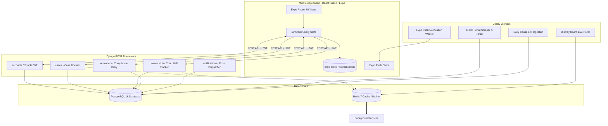

# APHC Case Tracker — Architecture Documentation

## 1. High-Level Architecture

The system is designed as a decoupled monorepo composed of a Django REST Framework backend with Celery background workers, PostgreSQL and Redis services, and a React Native Expo mobile application.

## 2. Backend Architecture (`backend/`)

- **`config/`**: Django project settings, WSGI/ASGI handlers, Celery instance, and root URL routing.
- **`accounts/`**: Advocate identity, Bar Council enrollment number verification, custom User model, SimpleJWT authentication, and team permissions.
- **`cases/`**: Case metadata (WP, WA, CRP, etc.), petitioner/respondent records, order PDFs, and case stage timelines.
- **`reminders/`**: Compliance deadlines (counter-affidavit, batta, process fee), limitation tracking, and advocate diary.
- **`tokens/`**: Andhra Pradesh High Court live display board monitor, Court Hall item tracking, and distance-to-hearing calculation.
- **`notifications/`**: Push notification dispatching, device token registry, notification history, and category subscriptions.
- **`tests/`**: Pytest test suite covering all apps, API contracts, and edge cases.

## 3. Mobile Architecture (`mobile/`)

- **`app/`**: File-based routing with Expo Router:
  - `(auth)`: Login, Register, Forgot Password.
  - `(tabs)`: Dashboard, Cases, Cause List, Display Board, Diary.
  - `cases/[id]`: Detailed case timeline, order history, and court hall tracking.
- **`components/`**: Modular UI components (buttons, cards, badges, status chips, loading skeletons).
- **`services/`**: Axios API client with SimpleJWT token rotation, TanStack Query client configuration.
- **`i18n/`**: Localization setup using `i18next` and `react-i18next` supporting English (`en`) and Telugu (`te`).
- **`tests/`**: Jest and React Native Testing Library tests for screens, components, and hooks.
