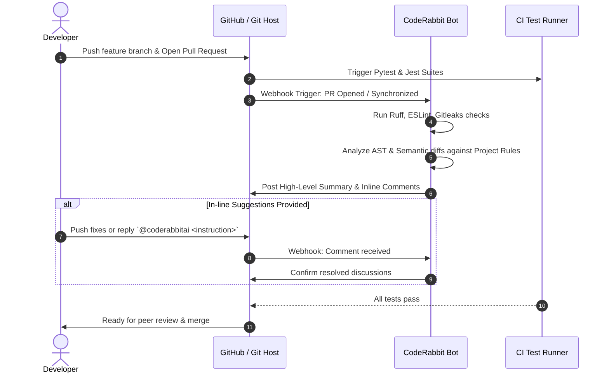

# CodeRabbit Pull-Request Review Workflow

## 1. Overview

[CodeRabbit](https://coderabbit.ai) is an AI-powered code review platform integrated into the repository to enforce code standards, detect security vulnerabilities, verify architecture rules, and summarize pull requests.

## 2. Configuration (`.coderabbit.yaml`)

The repository includes `.coderabbit.yaml` at the root which sets:

- **Tone & Profile**: `chill` profile for balanced, actionable insights without unnecessary pedantry.
- **Auto Review**: Enabled for all pull requests targeting `main`, `master`, and `develop`.
- **Integrated Linters**:
  - `ruff`: Python linting and formatting verification.
  - `eslint`: TypeScript and React Native linting verification.
  - `gitleaks`: Automated secret and private key detection.
- **Path Exclusions**: Ignores lockfiles, test coverage reports, `.venv/`, and `node_modules/`.

## 3. Pull Request Review Lifecycle

## 4. CodeRabbit Interactive Commands

In PR discussions, team members can interact with CodeRabbit by posting comments:

- `@coderabbitai summary`: Re-generate high-level pull request summary.
- `@coderabbitai review`: Re-run full review after pushing commits.
- `@coderabbitai resolve`: Auto-resolve discussion threads if fixes have been committed.
- `@coderabbitai chat <question>`: Ask CodeRabbit questions regarding architecture, edge cases, or optimization suggestions.

## 5. Review Guidelines for Contributors

1. **Never commit real secrets**: CodeRabbit's gitleaks hook will block any PR with real API keys or JWT secrets.
2. **Review High-Level Walkthrough**: Check CodeRabbit's auto-generated walkthrough to ensure all changed files were intended.
3. **Address all blocking comments**: Any potential race conditions, unhandled null pointers in React Native, or unindexed database queries must be resolved prior to merging into main.
