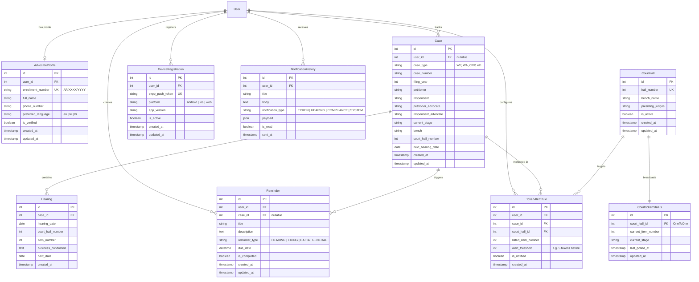

# APHC Case Tracker — Database Design Documentation

This document describes the relational database schema, model definitions, foreign key relationships, indexes, and constraints for the High Court of Andhra Pradesh Case Tracker.

---

## 1. Entity-Relationship (ER) Diagram

---

## 2. Table Specifications & Indexes

### 2.1 `accounts_advocateprofile`

- **Primary Key**: `id` (BigAutoField)
- **Unique Constraints**:
  - `enrollment_number` (must match regex `^[A-Z]{2}/[0-9]{1,6}/(19|20)[0-9]{2}$`)
  - `user_id` (One-to-One with `auth_user`)
- **Indexes**:
  - `idx_advocate_enrollment` (`enrollment_number`)
  - `idx_advocate_verified` (`is_verified`)

### 2.2 `cases_case`

- **Primary Key**: `id` (BigAutoField)
- **Unique Constraints**:
  - `unique_together`: `['case_type', 'case_number', 'filing_year']`
- **Indexes**:
  - `idx_case_lookup` (`case_type`, `case_number`, `filing_year`)
  - `idx_case_hearing_date` (`next_hearing_date`)
  - `idx_case_hall` (`court_hall_number`)

### 2.3 `cases_hearing`

- **Primary Key**: `id` (BigAutoField)
- **Foreign Keys**: `case_id` references `cases_case(id)` on delete CASCADE.
- **Indexes**:
  - `idx_hearing_case_date` (`case_id`, `hearing_date`)

### 2.4 `reminders_reminder`

- **Primary Key**: `id` (BigAutoField)
- **Foreign Keys**:
  - `user_id` references `auth_user(id)` on delete CASCADE.
  - `case_id` references `cases_case(id)` on delete SET_NULL.
- **Indexes**:
  - `idx_reminder_user_due` (`user_id`, `due_date`, `is_completed`)

### 2.5 `tokens_courthall` & `tokens_courttokenstatus`

- **Primary Key**: `id` (BigAutoField)
- **Unique Constraints**: `hall_number` on `CourtHall`.
- **Relationship**: `CourtTokenStatus` has `OneToOneField` to `CourtHall`.
- **Indexes**:
  - `idx_hall_number` (`hall_number`)
  - `idx_token_updated` (`updated_at`)

### 2.6 `notifications_deviceregistration`

- **Primary Key**: `id` (BigAutoField)
- **Unique Constraints**: `expo_push_token`.
- **Indexes**:
  - `idx_device_user_active` (`user_id`, `is_active`)

---

## 3. Database Engine Portability

- **Local Development**: Supported on SQLite (`db.sqlite3`) for lightweight testing without external services.
- **Production**: Configured for PostgreSQL 16 via `psycopg` (v3) with connection pooling and SSL mode.
